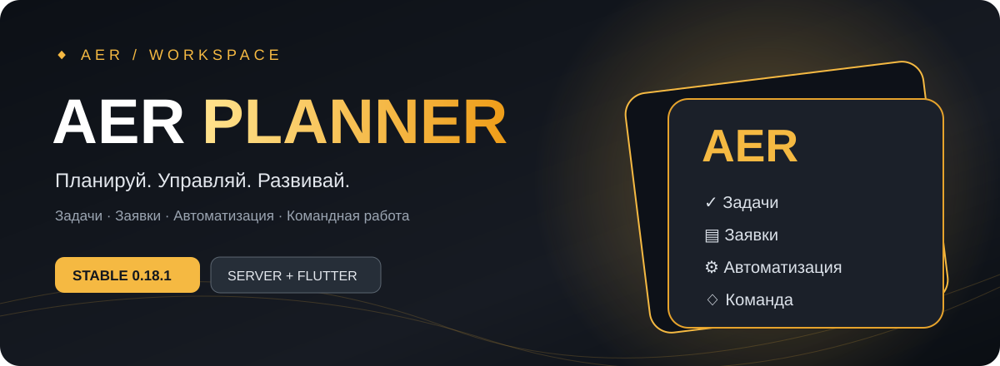

 

**WINDOWS DESKTOP** · **STABLE 0.18.1** · **НОВЫЕ ПЛАТФОРМЫ В РАЗРАБОТКЕ**

### Планируй. Управляй. Развивай.

AER Planner — рабочее пространство для управляющего розничной точкой. Задачи, заметки, заявки сотрудников и автоматизация повседневной работы.

---

<table>
<tr><td width="33%" align="center"><h3>▤ Задачи</h3>Планирование работы и контроль дел</td><td width="33%" align="center"><h3>▧ Заметки</h3>Важная информация под рукой</td><td width="33%" align="center"><h3>✦ Автоматизация</h3>Сценарии для регулярных процессов</td></tr>
<tr><td align="center"><h3>✉ Заявки</h3>Обращения сотрудников и их статусы</td><td align="center"><h3>▦ Команда</h3>Работа управляющего и продавцов в LAN</td><td align="center"><h3>↻ Обновления</h3>Встроенная проверка новых версий</td></tr>
</table>

> **Что доступно сейчас:** в версии 0.18.1 личные задачи и заметки управляющего хранятся локально. Для продавцов предусмотрен браузерный интерфейс заявок в локальной сети. Серверная платформа и новые клиенты ещё разрабатываются.

---

### Скачать AER Planner для Windows

**Последняя стабильная версия — 0.18.1**

Откройте Assets на странице релиза и скачайте установочный файл .exe.

---

### Что дальше?

| Платформа | Состояние |
|:--|:--|
| **Windows — управляющий** | Стабильная версия доступна |
| **Серверная платформа** | В разработке |
| **Windows — продавец** | В разработке |
| **Android** | В разработке, APK пока нет |
| **iOS** | В разработке, версия для установки пока недоступна |

Наша цель — единая система с серверной логикой и удобными клиентами для разных устройств. Сроки релизов объявим после готовности.

---

### ▣ AER Planner для смартфонов

*Мобильные версии готовятся. QR-коды пока ведут к информации о разработке.*

<table><tr>
<td width="50%" align="center"><h3>Android</h3> <b>СКОРО</b></td>
<td width="50%" align="center"><h3>iOS</h3> <b>СКОРО</b></td>
</tr></table>

<b>Android — скоро</b>
APK пока не опубликован. Новости о выпуске — в [Telegram](https://t.me/aer_planner).

<b>iOS — скоро</b>
Приложение пока не опубликовано. Новости о выпуске — в [Telegram](https://t.me/aer_planner).

---

### Кратко о ходе работ

**Windows 0.18.1 — выпущен** · **Сервер — в работе** · **Новые клиенты — в работе**

Поддерживаем стабильный выпуск и параллельно развиваем новую архитектуру. Главные новости и демонстрации публикуем в нашем канале.

 

**AER PLANNER** · *Планируй. Управляй. Развивай.*

Официальный репозиторий установщиков и обновлений AER Planner.

